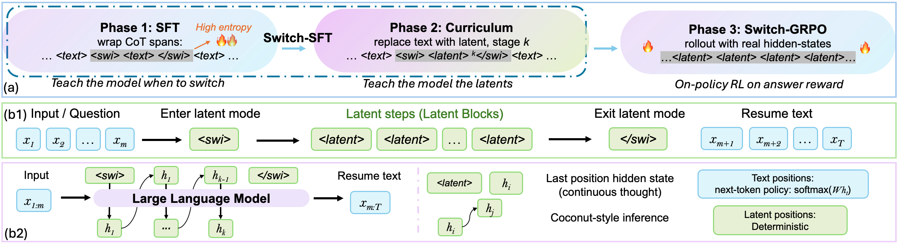

<div align="center">

# SWITCH

### Demystifying Hidden-State Recurrence: Switchable Latent Reasoning with On-Policy Reinforcement Learning

[](https://arxiv.org/abs/2606.13106)  [](#-released-artefacts)  [](LICENSE)



</div>

**SWITCH** is a switchable latent chain-of-thought framework that combines
Coconut-style hidden-state recurrence with on-policy reinforcement learning
through a single primitive: a pair of learned boundary tokens
`<swi>` / `</swi>`. The boundaries (i) make on-policy RL well-defined on
hidden-state-recurrence latents and (ii) expose the latent computation to
direct mechanistic analysis.

> **TL;DR.** Hidden-state-recurrence latent CoT is hard to optimise with
> standard on-policy RL and hard to interpret causally. We show that adding
> two discrete boundary tokens fixes both. Trained on Qwen3-8B, **SWITCH
> reaches 79.3 % on MATH-500 (+25.7 over the strongest Coconut-style baseline
> at the same scale) and 89.2 % on GSM8K**, while making three mechanistic
> claims about the switch policy and the latent step verifiable by direct
> probing and causal intervention.

## What's in this repository

```
src/
├── model/coconut_swi_model.py    Coconut-style hidden-state injection wrapper
├── rl/grpo.py                    Switch-GRPO loss (PPO-clipped, KL-anchored)
├── rl/reward.py                  Correctness / format / latent-usage / brevity rewards
├── rl/rollout.py                 Multi-pass forward rollout with hidden-state injection
├── data/coconut_swi_dataset.py   Phase 1 / Phase 2 datasets
└── setup_tokens.py               Vocabulary surgery for <swi>, </swi>, <latent>

train_phase1.py            Phase 1: SFT (locate switch positions)
train_phase2.py            Phase 2: latent curriculum (parallel schedule by default)
train_phase3_grpo.py       Phase 3: Switch-GRPO on-policy RL
train_phase3_rl.py         Alt RL entry point

scripts/
├── eval_{gsm8k,math500,latent}.py   Evaluation drivers
├── interpret_swi.py                 Mechanistic analysis (probe / intervention / logit-lens / ...)
├── prep_*.py, preprocess_*.py       Data preparation
├── train_*.sh, run_*.sh             End-to-end shell launchers
└── ds_config_zero3.json             DeepSpeed config

tests/test_rl_pipeline.py            Sanity-check for the RL pipeline
```

## 🤗 Released artefacts

| Asset | HF Hub | Description |
|-------|--------|-------------|
| **Phase 3 (Switch-GRPO) LoRA** | [🤗 LARK-Lab/SWITCH-Phase3-GRPO-LoRA-Qwen3-8B](https://huggingface.co/LARK-Lab/SWITCH-Phase3-GRPO-LoRA-Qwen3-8B) | Paper-final checkpoint: 79.3 % MATH-500, 89.2 % GSM8K on Qwen3-8B |
| **Math training set** | [🤗 LARK-Lab/SWITCH-Math-Train](https://huggingface.co/datasets/LARK-Lab/SWITCH-Math-Train) | OpenR1-Math subset annotated with `<swi>/</swi>` boundaries + GRPO rollout prompts |

(Intermediate Phase 1 / Phase 2 trajectories and mechanistic-analysis raw
outputs are kept for reproducibility but not part of the public release.)

## Quick start

### Install

```bash
git clone https://github.com/LARK-AI-Lab/SWITCH
cd SWITCH
pip install -r requirements.txt
```

### Inference with the released SWITCH-GRPO LoRA

```python
from peft import PeftModel
from transformers import AutoModelForCausalLM, AutoTokenizer
import torch

BASE    = "Qwen/Qwen3-8B"
ADAPTER = "<HF-ORG>/SWITCH-Phase3-GRPO-LoRA-Qwen3-8B"   # public release

# Tokenizer ships with <swi>, </swi>, <latent> already registered.
tokenizer = AutoTokenizer.from_pretrained(ADAPTER)
model     = AutoModelForCausalLM.from_pretrained(
    BASE, torch_dtype=torch.bfloat16, device_map="auto"
)
model.resize_token_embeddings(len(tokenizer))
model     = PeftModel.from_pretrained(model, ADAPTER)
model.eval()
```

`model.generate(...)` will treat `<latent>` as an ordinary placeholder. To
actually run the Coconut-style hidden-state recurrence inside `<swi>...</swi>`
blocks, use the SWITCH inference loop in
[`src/model/coconut_swi_model.py`](src/model/coconut_swi_model.py).

### Reproduce the training pipeline

```bash
# Phase 1: locate switch positions
bash scripts/run_stage1_sft.sh

# Phase 2: latent curriculum (parallel schedule, default)
bash scripts/train_phase2_phase2-1.sh

# Phase 3: Switch-GRPO
bash scripts/train_phase3_grpo.sh
```

## The three mechanistic findings

The boundary tokens let us look inside the trained model. The paper reports
three converging takeaways (each one is a separate paper subsection) that you
can reproduce with `scripts/interpret_swi.py`:

1. **`<swi>` is a learned switching policy, not a stylistic tag.** It is
   sharply localised at annotated boundaries (rank ≤ 2 vs rank ≈ 10³ at random
   positions), forms a clean one-token spike of `p(<swi>)`, and is linearly
   decodable from late hidden states (~91.9 %) before the LM head.
2. **The latent step performs causally important computation, not generic
   filler.** Zeroing the injected hidden states reduces accuracy by roughly
   two-thirds on problems that use latent reasoning, while a same-norm random
   replacement costs only a few points.
3. **The work in the latent block is concentrated at a single hidden-state
   transition on entry**, kept alive by the `K_min` constraint; subsequent
   steps are near-deterministic exits with `p(</swi>) ≈ 1`.

```bash
# all three live in scripts/interpret_swi.py
python scripts/interpret_swi.py teacher-forced  --adapter_path <CKPT>
python scripts/interpret_swi.py switch-window   --adapter_path <CKPT>
python scripts/interpret_swi.py probe           --adapter_path <CKPT>
python scripts/interpret_swi.py intervention    --adapter_path <CKPT> --n 50
python scripts/interpret_swi.py logit-lens      --adapter_path <CKPT>
```

## Citation

```bibtex
@misc{yang2026demystifyinghiddenstaterecurrenceswitchable,
  title         = {Demystifying Hidden-State Recurrence: Switchable Latent Reasoning with On-Policy Reinforcement Learning},
  author        = {Jiayu Yang and Chao Chen and Shengen Wu and Yinhong Liu and Yuxuan Fan and Lujundong Li and Songning Lai and Chengwei Qin and Zhijiang Guo},
  year          = {2026},
  eprint        = {2606.13106},
  archivePrefix = {arXiv},
  primaryClass  = {cs.LG},
  url           = {https://arxiv.org/abs/2606.13106}
}
```

## License

MIT.

## Acknowledgements

Built on top of Qwen3-8B. The latent recurrence formulation follows
Coconut (Hao et al., 2025); the boundary-token annotation pipeline adapts
SwiReasoning (Shi et al., 2026); the GRPO optimiser builds on DeepSeekMath
(Shao et al., 2024) and the verl framework (Sheng et al., 2024).
